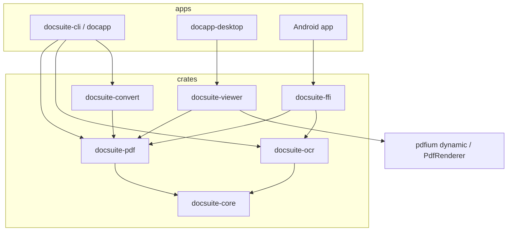

# Waghitech Docapp

Local-first document toolkit: a small Rust engine for PDF work on desktop and Android. Nothing runs in the cloud.

## Feature status

| Area | Status |
| --- | --- |
| PDF info, split, merge, rotate, crop, reorder, delete | Done |
| Text/image stamps, visible signature block | Done |
| CLI field-type detection (OCR heuristics) | Done |
| Image → PDF (JPEG/PNG) | Done |
| Printed OCR (ocrs) | Planned |
| Handwriting models | Planned (optional download) |
| ODT ↔ DOCX (shared document model) | Done |
| Word/ODT → PDF (Typst, CLI/desktop) | Done |
| Image → ODT/DOCX (fit page) | Done |
| DOCX/ODT → PNG (via PDF + pdfium) | Done (CLI/desktop) |
| Word/ODT → PDF (Android FFI) | Coming soon (Typst size) |
| PDF → Word (exact-look & editable) | Done |

## Architecture



Rendering: Android uses the system `PdfRenderer`; desktop loads pdfium dynamically when available.

## Quickstart

```bash
cargo build --release -p docsuite-cli
```

```bash
./target/release/docapp info sample.pdf
./target/release/docapp split in.pdf --ranges 1-3,5 -o parts/   # one file per comma group
./target/release/docapp split in.pdf --ranges 1-3,5 --single -o all.pdf
./target/release/docapp convert scan.png -o scan.pdf
./target/release/docapp convert in.pdf -o out.docx --mode exact --pages 1-3
./target/release/docapp convert doc.odt -o doc.docx
./target/release/docapp convert doc.docx -o doc.pdf
./target/release/docapp convert scan.png -o page.odt
./target/release/docapp detect-type "ek@example.com"
```

Desktop:

```bash
cargo run --release -p docapp-desktop
```

Android (after NDK + rustup Android targets):

```bash
./build-android.sh
```

## Size goals

Release profile uses `opt-level = "z"`, fat LTO, single codegen unit, and strip — favouring small binaries and low RAM over compile speed.

## License

MIT OR Apache-2.0